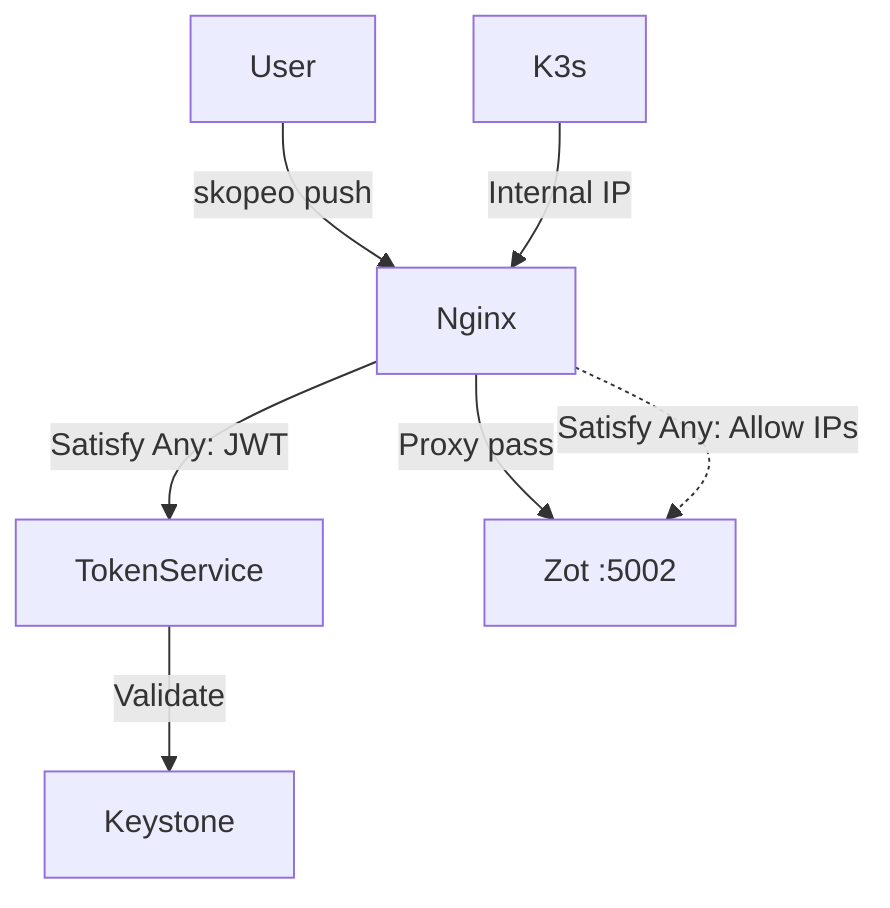

# Architecting a Private Cloud

From IaaS to Kubernetes with **OpenStack**, **K3s**, and **Zot**

<div class="pt-12 text-sm text-gray-500">
  Press Space for next page
</div>

---
layout: center
class: text-center
---

# Overview

Transforms a single bare-metal machine into a fully operational private cloud platform.

- **OpenStack** — IaaS layer (Keystone, Nova, Neutron, Cinder)
- **K3s** — Lightweight Kubernetes cluster (1 master + 1 worker)
- **Zot** — Private OCI container registry with Cinder-backed storage
- **Nginx + Token Service** — Custom Auth proxy merged into the registry VM
- **Keystone Application Credentials** — K8s pulls images with OpenStack-native auth

---
layout: default
---

# Step-by-Step Journey

From bare-metal to working K3s cluster:

1. **Create DevStack VM**: `16 GB RAM`, `6 vCPU`, `80 GB disk` on `libvirt/KVM`.
2. **Install DevStack**: Key, Nova, Neutron, Cinder services over Ubuntu 24.04.
3. **OpenStack Bootstrap**: Create tenants, quotas, networks (`cluster-net` & `services-net`), and routers.
4. **Provision VMs**:
   - `k3s-master-01` (K3s Server)
   - `registry-01` (Zot + Nginx Auth Proxy + Cinder Volume)
   - `k3s-worker-01` (K3s Agent)
5. **Final Integration**: Tie K3s, Zot, and Keystone Auth together.

---
layout: center
class: text-center
---

# OpenStack Services Deep Dive

Exploring the IaaS foundation.

---
layout: default
---

# 1. Keystone (Identity)

Keystone provides the core authentication and authorization layer.

* **Tenants & Users:** Bootstraps the `k3s-project` and `k3s-user`.
* **Application Credentials:**
  * Generates `auth-proxy-system` for the Nginx token service validation.
  * Allows developers to create short-lived credentials for deployments (e.g., `skopeo push`).
* **K8s Integration:** Secures the K8s `ImagePullSecret` by mapping directly to OpenStack native permissions.

---
layout: default
---

# 2. Nova (Compute)

Nova provisions and manages the lifecycle of the nested Tenant VMs.

* **Hypervisor:** Uses `libvirt` with the `KVM` driver running inside the DevStack VM. (Nested Virtualization)
* **Tenant Instances:** 
  * `k3s-master-01` (`m1.medium` - 4GB, 2 vCPU)
  * `registry-01` (`m1.small` - 2GB, 1 vCPU)
  * `k3s-worker-01` (`ds1G` - 1GB, 1 vCPU, 10GB disk - custom flavor)
* **Placement:** Evaluates hypervisor constraints ensuring proper scheduling without disk exhaustion.

---
layout: default
---

# 3. Neutron (Networking)

Neutron handles SDN, tenant isolation, and L3 routing.

* **Backend:** Powered by `OVN` (Open Virtual Network) and Open vSwitch (`br-int`, `br-ex`).
* **Topology:**
  * `k3s-cluster-net` (10.10.0.0/24) for K3s nodes.
  * `k3s-services-net` (10.20.0.0/24) for the registry.
* **Routing:** `k3s-router` connects tenant networks to the external `public` network.
* **Floating IPs:** 1:1 NAT mapping external IPs (`192.168.122.x`) to internal VM fixed IPs, granting inbound/outbound access.

---
layout: default
---

# 4. Cinder (Block Storage) & Glance

**Cinder (Block Storage):**
* Provides persistent, block-level storage volumes via an `LVM` backend.
* **Usage:** A highly available `20GB` persistent block volume is attached securely to the `registry-01` VM formatted as `ext4`, serving as the primary datastore for the Zot OCI registry.

**Glance (Image Service):**
* Loads and streams the base `ubuntu-noble` (Ubuntu 24.04 QCOW2) cloud image into Nova.
* Ensures VMs boot with customized cloud-init injection.

---
layout: center
class: text-center
---

# Registry & Auth Proxy Architecture

Consolidated for efficiency and zero internal latency.

---
layout: two-cols
---

# Auth Proxy Design

<br>

<div class="pr-2 text-sm">

**The Problem:**
Native Zot CLI auth doesn't map to Keystone natively. K8s doesn't handle external OIDC dynamically for basic image pulls.

**The Solution:**
Merged architecture: Nginx proxy + Python Token Service + Zot localhost bindings.

**Flow:**
1. Push reaches `Nginx :5000` (FIP).
2. Nginx hits `/auth/token` on Token Service.
3. Token Service validates against `Keystone`.
4. Extracted JWT validates proxy to `Zot :5002`.

</div>

::right::

<br>

<div class="pl-2">



*Internal K3s pulls bypass auth via Nginx IP whitelisting (`10.10.0.0/24`).*

</div>

---
layout: center
class: text-center
---

# Networking Architecture 

From the host to the K8s pod.

---
layout: default
---

# Layers of Networking

1. **Host to DevStack**: Host `virbr0` NAT network connects to the DevStack `enp1s0` management interface.
2. **OVS Bridges**: DevStack's `enp2s0` connects to `br-ex`. Floating IP Gateway IP is assigned here.
3. **Host Route & RP Filter**: Host adds `ip route 192.168.122.200/29 via <DevStack_IP>` for asymmetric tracking, DevStack disables `rp_filter`.
4. **Neutron L3**: `qrouter` namespace handles 1:1 DNAT/SNAT between Floating IPs and Fixed IPs.
5. **K3s Overlay**: Flannel VXLAN runs over the Neutron cluster network (`10.10.0.0/24`) provisioning pod CIDRs (`10.42.x.x`).

---
layout: default
---

# Deployment Workflow

Seamless App Credential translation to Kubernetes deploy.

1. **Create App Credential** (Keystone):
   ```bash
   openstack application credential create deploy-app --unrestricted
   ```
2. **Push Image** (Skopeo to Floating IP):
   ```bash
   skopeo copy --dest-username='$APP_ID' --dest-password='$APP_SECRET' \
               docker://... docker://$AUTH_PROXY_FIP:5000/my-app:v1
   ```
3. **Kubernetes ImagePullSecret** (Internal Registry IP):
   ```bash
   kubectl create secret docker-registry registry-auth \
     --docker-server="$INTERNAL_REGISTRY" --docker-username="$APP_ID" ...
   ```
4. **Deploy Pod**: Spec points directly to `$INTERNAL_REGISTRY/my-app:v1`

---
layout: center
class: text-center
---

# Thank You!

Ready to deploy your next application over your own Private Cloud?
